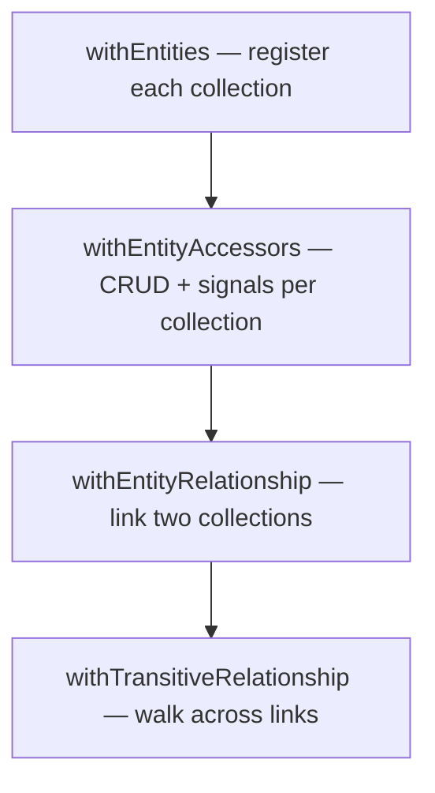
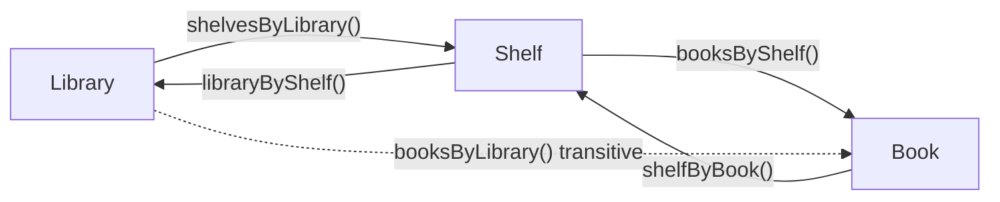

# signalkin

Relationships and everyday collection methods for [`@ngrx/signals`](https://ngrx.io/guide/signals) entities.

[](https://www.npmjs.com/package/signalkin)
[](LICENSE)
[](https://angular.dev)
[](https://ngrx.io/guide/signals)

- **`withEntityAccessors`** adds every collection's standard methods (add / set / upsert / update / remove, lookups, counts) in one call.
- **`withEntityRelationship`** relates two collections (1:many, N:many, m:n) with typed lookups both directions, plus link mutations.
- **`withTransitiveRelationship`** adds lookups that walk through intermediary collections.

Every generated member is named after your collection and fully typed.

---

## Install

```
npm install signalkin
```

Peer dependencies: `@angular/core` and `@ngrx/signals`.

---

## How it works

Add the features in this order (enforced at compile time):



With a `Library` that has many `Shelf`s and a `Shelf` that has many `Book`s, you get lookups in both directions, plus transitive lookups across the chain:



---

## Quick start

### 1. Describe your entities and their configs

```ts
import { entityConfig, type } from '@ngrx/signals/entities';

interface Library { id: string; name: string; }
interface Shelf   { id: string; libraryId: string; }
interface Book    { id: string; shelfId: string; title: string; }

const libraryConfig = entityConfig({ entity: type<Library>(), collection: 'library' });
const shelfConfig   = entityConfig({ entity: type<Shelf>(),   collection: 'shelf' });
const bookConfig    = entityConfig({ entity: type<Book>(),    collection: 'book' });
```

### 2. Register the collections with ngrx

```ts
import { signalStore } from '@ngrx/signals';
import { withEntities } from '@ngrx/signals/entities';

signalStore(
  { providedIn: 'root' },
  withEntities(libraryConfig),
  withEntities(shelfConfig),
  withEntities(bookConfig),
);
```

### 3. Add signalkin's features, in order

```ts
import { withEntityAccessors, withEntityRelationship, withTransitiveRelationship } from 'signalkin';

export const CatalogStore = signalStore(
  { providedIn: 'root' },
  withEntities(libraryConfig),
  withEntities(shelfConfig),
  withEntities(bookConfig),

  withEntityAccessors(),
  withEntityRelationship({ name: 'library', count: 1 }, { name: 'shelf', count: 'many' }),
  withEntityRelationship({ name: 'shelf',   count: 1 }, { name: 'book',  count: 'many' }),
  withTransitiveRelationship({ from: 'library', to: 'book', through: 'shelf' }),
);
```

### 4. Inject and use it

```ts
const store = inject(CatalogStore);

store.addBook({ id: 'b1', shelfId: 's1', title: 'Dune' });   // from withEntityAccessors
store.booksByShelfId('s1');                                  // -> Book[]
store.shelfByBook(book);                                     // -> Shelf | undefined
store.booksByLibrary(library);                               // -> Book[]   (walks library -> shelf -> book)
```

---

## API

### `withEntityAccessors(...configs)`

Standard collection methods and signals. No arguments covers every collection; pass configs to cover only those.

```ts
withEntityAccessors()                        // all collections
withEntityAccessors(bookConfig)              // book only
withEntityAccessors({ ...libraryConfig, plural: 'libraries' })   // irregular plural
```

For `collection: 'book'`:

| Kind | Members |
|---|---|
| Signals | `books()`, `bookMap()`, `bookCount()` |
| Lookups | `bookById(id)`, `hasBook(id)` |
| Add | `addBook(book)`, `addBooks(books)`, `prependBook(book)`, `prependBooks(books)` |
| Set | `setBook(book)`, `setBooks(books)`, `setAllBooks(books)` |
| Upsert | `upsertBook(book)`, `upsertBooks(books)` |
| Update | `updateBook(id, changes)`, `updateBooks(ids \| predicate, changes)`, `updateAllBooks(changes)` |
| Remove | `removeBook(id)`, `removeBooks(ids \| predicate)`, `removeAllBooks()` |

`changes` is a `Partial<Book>` or a `(book) => Partial<Book>` updater.

### `withEntityRelationship(from, to, options?)`

Relates two collections. Each side is `{ name, count, plural?, selectPrimaryId?, selectForeignId? }`:

- **`name`** the collection name.
- **`count`** how many of that side relate to one of the other: `1`, a fixed number (e.g. `2`), or `'many'`.
- **`plural`** the plural noun used in generated members. Default `` `${name}s` ``.
- **`selectPrimaryId`** how to read this entity's own id. Default the `id` property.
- **`selectForeignId`** how to read this entity's foreign key to the other side. Set it only on the side that stores the key. Default `` `${otherName}Id` `` (or `` `${otherName}Ids` `` for a side that links to more than one).

`options`: `autoIndex` (default `true`, index from foreign keys automatically) and `syncForeignKeys` (default `true`, `remove` / `move` write the entity's foreign key so the change sticks).

For `withEntityRelationship({ name: 'library', count: 1 }, { name: 'book', count: 'many' })`:

| Kind | Members |
|---|---|
| Index signals | `libraryBookMap()`, `bookLibraryMap()` |
| Lookups | `booksByLibrary(library)`, `booksByLibraryId(id)`, `bookIdsByLibrary(library)`, `bookIdsByLibraryId(id)` and the reverse four (`libraryByBook`, ...) |
| Checks | `libraryHasBook(libraryId, bookId)`, `bookHasLibrary(bookId, libraryId)`, `bookCountByLibrary(id)`, `libraryCountByBook(id)` |
| Mutations | `addBookToLibrary(libraryId, bookId)`, `removeBookFromLibrary(libraryId, bookId)`, `moveBookToLibrary(bookId, newLibraryId)` |

A side with a fixed `count` of 2 or more also gets composite set-lookups: `bookByAisles(...aisles)`, `bookByAisleIds(...ids)`, `bookIdByAisles(...aisles)`, `bookIdByAisleIds(...ids)`.

### `withTransitiveRelationship({ from, to, through, ... })`

Lookups between two collections that walk through the intermediary collection(s). `through` is one name or an ordered list. Config: `{ from, to, through, fromPlural?, toPlural?, selectFromId?, selectToId? }`. Register the direct relationship for every hop before this one.

For `{ from: 'author', to: 'comment', through: 'post' }`: `commentsByAuthor(author)`, `commentsByAuthorId(id)`, `commentIdsByAuthor(author)`, `commentIdsByAuthorId(id)` and the reverse four. Results are arrays both directions.

---

## Custom ids and plurals

Pass a config or `selectPrimaryId` / `selectForeignId` for a collection that keys on something other than `id`:

```ts
withEntityRelationship(
  { name: 'library', count: 1, selectPrimaryId: 'id2' },
  { name: 'book', count: 'many', selectPrimaryId: 'id2', selectForeignId: 'libraryId2' },
);
```

Default pluralization is `+s`. Set `plural` (or `fromPlural` / `toPlural` on a transitive config) for irregular nouns: `{ name: 'library', count: 'many', plural: 'libraries' }`.

---

## Develop

```
npx ng build signalkin   # build library to dist/signalkin
npx ng build sandbox      # type-check against the built package
npx ng test signalkin     # vitest suite
```

Build the library before the sandbox.

---

## License

MIT
