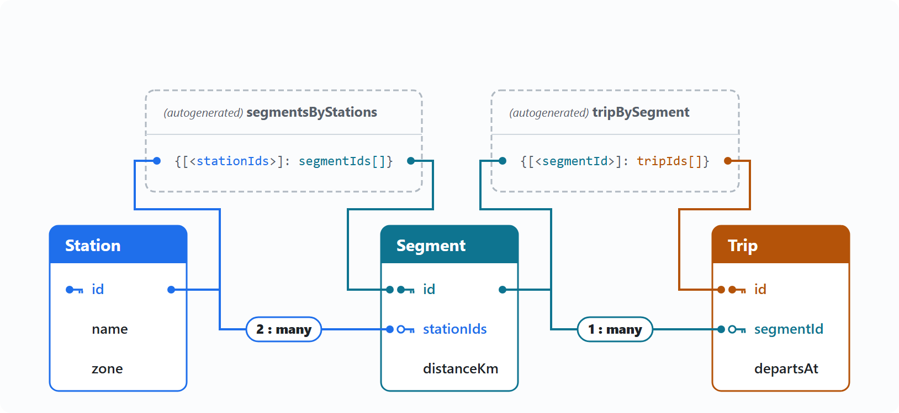
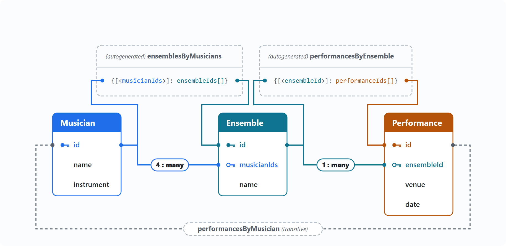
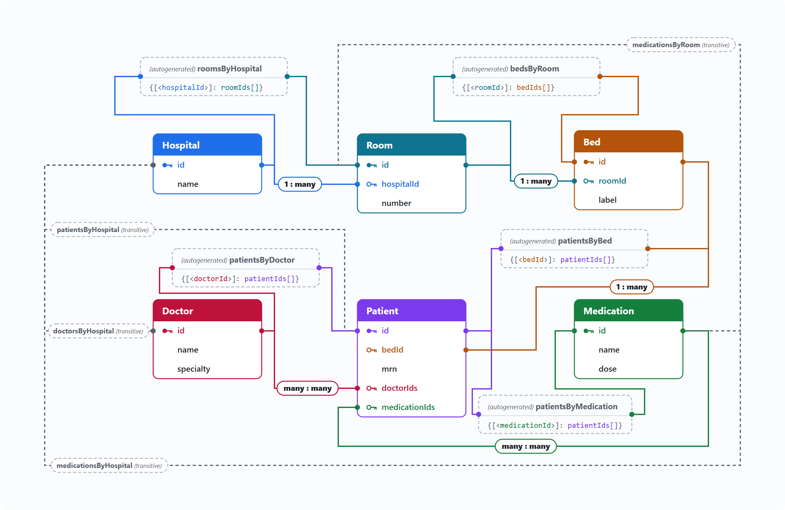

# signalkin

[](https://www.npmjs.com/package/signalkin)
[](LICENSE)
[](https://angular.dev)
[](https://ngrx.io/guide/signals)

Performant relationship management (1:many, 2:1) and collection methods for [`@ngrx/signals`](https://ngrx.io/guide/signals) entities.

---

## Contents

- [Install](#install)
- [Usage](#usage)
  - [`withEntityAccessors`](#method-withentityaccessorsconfigs)
  - [`withEntityRelationship`](#method-withentityrelationshipfrom-to-options)
  - [`withTransitiveRelationship`](#method-withtransitiverelationship-from-to-through--)
  - [Customization](#customization)
- [Recipes](#recipes)
  - [Transit map](#transit-map-the-segment-between-two-stations)
  - [Quartets](#quartets-an-ensemble-keyed-by-its-players-plus-a-transitive-walk)
  - [Hospital](#hospital-a-deep-hierarchy--many-to-many-loaded-from-an-api)
- [Contributing](#contributing)
- [License](#license)

---
## Install

```
npm install signalkin
```

Peer dependencies: `@angular/core` and `@ngrx/signals`

_See the [NgRx SignalStore entity management guide](https://ngrx.io/guide/signals/signal-store/entity-management) to learn about entity signals and how to use them!_

---

## Usage

### Method: `withEntityAccessors(...configs)`
- Reduces boilerplate around entity signals (no need for `patchState`).

#### 1. Add to signal store
```ts
...
import { withEntityAccessors } from 'signalkin'; // <-- import

interface Task { id: string; }

export const TaskStore = signalStore(
    ...
    withEntities(entityConfig({ entity: type<Task>(), collection: 'task'})),
    withEntityAccessors() // <--- Add this
);
```

#### 2. Receive a bunch of getters/setters
```ts
@Component({
  selector: 'app-root'
})
export class App {
  constructor(){
    store = inject(TaskStore);
    
    // <-- you get free access to these signals:
    store.tasks(); // Array<Task>
    store.taskMap(); // Record<string, Task>
    store.taskCount(); // number
    store.taskById(id); // Task
    store.hasTask(id); // boolean
    
    // <-- as well as these signal setters:
    store.addTask(task);
    store.addTasks(tasks);
    store.prependTask(task);
    store.prependTasks(tasks);
    store.setTask(task);
    store.setTasks(tasks);
    store.setAllTasks(tasks);
    store.upsertTask(task);
    store.upsertTasks(tasks);
    store.updateTask(id, changes);
    store.updateTasks(ids, changes);
    store.updateAllTasks(changes)
    store.removeTask(id);
    store.removeTasks(ids);
    store.removeAllTasks();

    // <-- and entity order modifiers
    store.swapTasks(taskA, taskB);
    store.reorderTasks(orderedTasks);
    store.moveTaskToIndex(task, index);
  }
}
```

---

### Method: `withEntityRelationship(from, to, options?)`
- Lets you link two collections with primary and foreign keys - for frontend "database" management without the O(n^2) lookups

#### 1. Add to signalStore
```ts
import { withEntityRelationship } from 'signalkin'; // <-- import

interface Author { id: string; }
interface Editor { id: string; }
interface Book { id: string; authorId: string; editorIds: string[] } // <-- ids for the related entities

export const LibraryStore = signalStore(
  ...
  withEntities(entityConfig({ entity: type<Book>(), collection: 'book' })),
  withEntities(entityConfig({ entity: type<Author>(), collection: 'author' })),
  withEntities(entityConfig({ entity: type<Editor>(), collection: 'editor' })),

  // <-- Add these after your entities to describe their relationships:
  withEntityRelationship(
    { collection: 'author', count: 1 },
    { collection: 'book', count: 'many' }
  ), // use any number or 'many' as the count
  withEntityRelationship(
    { collection: 'book', count: 'many' },
    { collection: 'editor', count: 2 } // two editors per book
  )
);
```

#### 2. Receive cross-entity signals, methods and auto-updates to ids
```ts
@Component({
  selector: 'app-root'
})
export class App {
  constructor(){
    store = inject(LibraryStore);
    
    // <-- You get free access to these signal getters:
    store.bookHasAuthor(book, author);
    store.authorHasBook(author, book);
    store.bookCountByAuthor(author);
    store.authorCountByBook(book); // (in a 1:many relationship this will always be 1)
    
    store.booksByAuthor(author);
    store.bookIdsByAuthor(author);
    store.authorByBook(book);
    store.authorIdByBook(book);

    // These getters are mostly useful only when dealing with >1 counts like 2:many
    // They require ALL books be passed in to identify an author; if you need the author of one book just use `store.bookById(id).authorId`
    store.authorByBooks(...books);
    store.authorIdByBooks(...books);
    
    // <-- as well as these signal setters, which will update foreign key values for all entities involved:
    store.addBookToAuthor(authorId, bookId);
    store.removeBookFromAuthor(authorId, bookId);
    store.moveBookToAuthor(bookId, authorId);

    // <-- and entity order modifiers
    store.indexOfAuthorBook(book);
    store.swapAuthorBooks(bookA, bookB);
    store.reorderAuthorBooks(orderedBooks);
    store.moveAuthorBookToIndex(book, index);

    // <-- with 2+ owners (a book has 2 editors):
    store.indexOfEditorByBook(editor, book);
    store.swapEditorsByBook(editorA, editorB, book);
    store.reorderEditorsByBook(orderedEditors, book);
    store.moveEditorByBookToIndex(editor, index, book);
    store.booksByEditorAtIndex(editor, 0);
    store.bookIdsByEditorAtIndex(editor, 0);
  }
}
```

---

### Method: `withTransitiveRelationship({ from, to, through, ... })`

- Lookups between two collections that walk through intermediary collection(s)

#### 1. Add to signalStore
```ts
...
import { ..., withTransitiveRelationship } from 'signalkin'; // <-- import

interface Team { id: string; }
interface Project { id: string; teamId: string } // <-- add an id to the child for the parent entity
interface Task {id: string; projectId: string} // <-- add an id to the child for the parent entity (no need for the "grandparent" id)

export const TaskStore = signalStore(
  ...
  withEntities(entityConfig({ entity: type<Team>(), collection: 'team' })),
  withEntities(entityConfig({ entity: type<Project>(), collection: 'project' })),
  withEntities(entityConfig({ entity: type<Task>(), collection: 'task' })),

  // Define 2 or more relationships
  withEntityRelationship({ collection: 'team', count: 1 }, { collection: 'project', count: 'many' }),
  withEntityRelationship({ collection: 'project', count: 1 }, { collection: 'task', count: 'many' }),

  withTransitiveRelationship({ from: 'team', to: 'task', through: 'project' }), // <-- Add this to get a "grandparent" relationship
);
```
#### 2. Receive grandparent-to-grandchild signals getters:
```ts
@Component({
  selector: 'app-root'
})
export class App {
  constructor(){
    store = inject(TaskStore);
    
    // <-- Now you get access to these getters:
    store.tasksByTeam(team);
    store.taskIdsByTeam(team);

    // <-- As well as the reverse direction:
    store.teamsByTask(task);
    store.teamIdsByTask(task);
  }
}
```

---

### Customization

#### Custom id property
- Set `selectId` / `selectForeignId` for a collection that keys on something other than `id` or `<foreignCollection>Id`:

```ts
withEntityRelationship(
  { collection: 'team', count: 1, selectId: 'id2' }, // <-- Bypass the default that looks for the primary key `id` on each team
  { collection: 'project', count: 'many', selectId: 'id2', selectForeignId: 'teamId2' }, // <-- Bypass the default that looks for the foreign key `teamId` (or teamIds for a 'many' relationship) on each project
  // `selectForeignId` also takes a callback, but doing so will prevent signalkin from cleaning up foreign keys for you

)
```

#### Pluralization
- Default pluralization adds an `s` to the collection name. Set `plural` / `fromPlural` / `toPlural` for an irregular noun:

```ts

withEntityAccessors({ ...libraryConfig, plural: 'libraries' }); // <-- plural
withEntityRelationship({ collection: 'library', count: 'many', plural: 'libraries' }, ...); // <-- plural
withTransitiveRelationship({from: 'library', to: 'shelf', through: ['row'], fromPlural: 'libraries', toPlural: 'shelves'}); // <-- fromPlural, toPlural
```

#### Disable auto-updates
- If you don't want signalkin to update the store on your behalf you can turn it off, one relationship at a time:
```ts
withEntityRelationship(
  { collection: 'team', count: 1},
  { collection: 'project', count: 'many'},
  {
    autoIndex: false, // <-- stop signalkin from automatically building lookup tables from foreign keys like {'authorId1': 'bookId1'}
    syncForeignKeys: false, // <-- stop signalkin from clearing a project's teamId when you delete its team
    compositeLookups: false // <-- stop signalkin from building many-to-one lookup tables like {'editor1editor2': 'bookId1'}
  }
);
```
---

## Recipes

### Transit map: the segment between two stations

- **Description:** Exactly two stations are joined by one track `Segment`; a station touches many segments; a segment carries many trips. A `count: 2` side makes the pair of station ids a composite key, so you can look the segment up from its two endpoints.



```ts
interface Station { id: string; name: string; zone: number; }
interface Segment { id: string; stationIds: [string, string]; distanceKm: number; }
interface Trip { id: string; segmentId: string; departsAt: string; }

export const NetworkStore = signalStore(
  withEntities(entityConfig({ entity: type<Station>(), collection: 'station' })),
  withEntities(entityConfig({ entity: type<Segment>(), collection: 'segment' })),
  withEntities(entityConfig({ entity: type<Trip>(), collection: 'trip' })),
  withEntityAccessors(),
  withEntityRelationship({ collection: 'station', count: 2 }, { collection: 'segment', count: 'many' }),
  withEntityRelationship({ collection: 'segment', count: 1 }, { collection: 'trip', count: 'many' }),
);
```

```ts
@Component({
  template: `
    @if (store.segmentByStations(from(), to()); as segment) {
      <p>{{ segment.distanceKm }} km | {{ store.tripCountBySegment(segment.id) }} trips/day</p>
    }
  `,
})
export class RouteInfo {
  store = inject(NetworkStore);
  from = input.required<string>();
  to = input.required<string>();
}
```

---

### Quartets: an ensemble keyed by its players, plus a transitive walk

- **Description:** A string quartet is defined by its four players; a musician plays in many ensembles; an ensemble gives many performances. `count: 4` makes the set of four musician ids a composite key, and a transitive lookup walks a musician through their ensembles to every performance.



```ts
interface Musician { id: string; name: string; instrument: string; }
interface Ensemble { id: string; name: string; musicianIds: [string, string, string, string]; }
interface Performance { id: string; ensembleId: string; venue: string; date: string; }

export const ConcertStore = signalStore(
  withEntities(entityConfig({ entity: type<Musician>(), collection: 'musician' })),
  withEntities(entityConfig({ entity: type<Ensemble>(), collection: 'ensemble' })),
  withEntities(entityConfig({ entity: type<Performance>(), collection: 'performance' })),
  withEntityAccessors(),
  withEntityRelationship({ collection: 'musician', count: 4 }, { collection: 'ensemble', count: 'many' }),
  withEntityRelationship({ collection: 'ensemble', count: 1 }, { collection: 'performance', count: 'many' }),
  withTransitiveRelationship({ from: 'musician', to: 'performance', through: 'ensemble' }),
);
```

```ts
@Component({
  template: `
    @if (store.ensembleByMusicians(violin1(), violin2(), viola(), cello()); as ensemble) {
      <p>{{ ensemble.name }} - {{ store.performancesByMusician(violin1()).length }} performances</p>
    }
  `,
})
export class QuartetCard {
  store = inject(ConcertStore);
  violin1 = input.required<string>();
  violin2 = input.required<string>();
  viola = input.required<string>();
  cello = input.required<string>();
  musicians = []
}
```

---

### Hospital: a deep hierarchy + many-to-many, loaded from an API

- **Description:** A hospital has rooms, rooms have beds, a bed holds a patient; a patient is linked to many doctors and many medications. Transitive lookups walk the whole chain - `medicationsByHospital` even crosses the patient→medication many-to-many - and `rxMethod` loads the graph from an API into the store, where every index builds itself.



```ts
interface Hospital { id: string; name: string; }
interface Room { id: string; hospitalId: string; number: string; }
interface Bed { id: string; roomId: string; label: string; }
interface Patient { id: string; bedId: string; mrn: string; doctorIds: string[]; medicationIds: string[]; }
interface Doctor { id: string; name: string; specialty: string; }
interface Medication { id: string; name: string; dose: string; }
interface HospitalGraph { hospitals: Hospital[]; rooms: Room[]; beds: Bed[]; patients: Patient[]; doctors: Doctor[]; medications: Medication[]; }

export const HospitalStore = signalStore(
  withEntities(entityConfig({ entity: type<Hospital>(), collection: 'hospital' })),
  withEntities(entityConfig({ entity: type<Room>(), collection: 'room' })),
  withEntities(entityConfig({ entity: type<Bed>(), collection: 'bed' })),
  withEntities(entityConfig({ entity: type<Patient>(), collection: 'patient' })),
  withEntities(entityConfig({ entity: type<Doctor>(), collection: 'doctor' })),
  withEntities(entityConfig({ entity: type<Medication>(), collection: 'medication' })),
  withEntityAccessors(),
  withEntityRelationship({ collection: 'hospital', count: 1 }, { collection: 'room', count: 'many' }),
  withEntityRelationship({ collection: 'room', count: 1 }, { collection: 'bed', count: 'many' }),
  withEntityRelationship({ collection: 'bed', count: 1 }, { collection: 'patient', count: 'many' }),
  withEntityRelationship({ collection: 'doctor', count: 'many' }, { collection: 'patient', count: 'many' }),
  withEntityRelationship({ collection: 'patient', count: 'many' }, { collection: 'medication', count: 'many' }),
  withTransitiveRelationship({ from: 'hospital', to: 'patient', through: ['room', 'bed'] }),
  withTransitiveRelationship({ from: 'hospital', to: 'medication', through: ['room', 'bed', 'patient'] }),
  withTransitiveRelationship({ from: 'hospital', to: 'doctor', through: ['room', 'bed', 'patient'] }),
  withTransitiveRelationship({ from: 'room', to: 'medication', through: ['bed', 'patient'] }),
  withMethods((store, http = inject(HttpClient)) => ({
    load: rxMethod<string>(
      pipe(
        switchMap((hospitalId) => http.get<HospitalGraph>(`/api/hospitals/${hospitalId}/graph`)),
        tap((graph) => {
          store.setAllHospitals(graph.hospitals);
          store.setAllRooms(graph.rooms);
          store.setAllBeds(graph.beds);
          store.setAllPatients(graph.patients);
          store.setAllDoctors(graph.doctors);
          store.setAllMedications(graph.medications);
        }),
      ),
    ),
  })),
);
```

```ts
@Component({
  template: `
    <h3>{{ store.hospitalById(hospitalId())?.name }}</h3>
    <p>
      {{ store.patientsByHospital(hospitalId()).length }} patients,
      {{ store.medicationsByHospital(hospitalId()).length }} medications in use
    </p>
  `,
})
export class HospitalDashboard {
  store = inject(HospitalStore);
  hospitalId = input.required<string>();

  constructor() {
    this.store.load(this.hospitalId); // rxMethod takes the signal and reloads when it changes
  }
}
```

---
## Contributing

Contributions are welcome!

### Project structure

This repo is an Angular workspace with two projects:
- `projects/signalkin` (the published library, source in `src/lib`) and
- `projects/sandbox` (a throwaway app whose `demo.store.typecheck.ts` asserts the generated types resolve through the built package).

Everything is a plain `signalStoreFeature` built only on public `@angular/core` + `@ngrx/signals` APIs, with no state duplication for FK-derived links (indexes are `computed`) and no effects or watchers.

_For AI Agents: [`AGENTS.md`](AGENTS.md)._

### Submitting
1. Add tests, including a sandbox type assertion for any type-level change.
2. Make sure all three pass:
```
npm run build            # sync the README, then build the library to dist/signalkin (build this before the sandbox)
npx ng build sandbox     # type-check the sandbox against the built package
npx ng test signalkin    # vitest suite
```
3. Create a feature branch with your name and short description and open a PR on `main`.

---

## License

MIT
