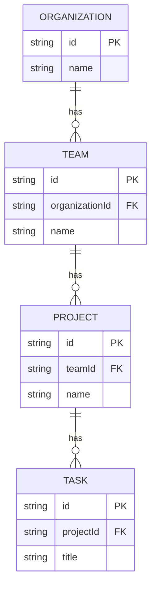

# signalkin

Relationships and everyday collection methods for [`@ngrx/signals`](https://ngrx.io/guide/signals) entities.

[](https://www.npmjs.com/package/signalkin)
[](LICENSE)
[](https://angular.dev)
[](https://ngrx.io/guide/signals)

- **`withEntityAccessors`** adds every collection's standard methods (add / set / upsert / update / remove, lookups, counts) in one call.
- **`withEntityRelationship`** relates two collections (1:many, N:many, m:n) with typed lookups both directions, plus link mutations.
- **`withTransitiveRelationship`** adds lookups that walk through intermediary collections.

Every generated member is named after your collection and fully typed.

The examples below model this database:



---

## Install

```
npm install signalkin
```

Peer dependencies: `@angular/core` and `@ngrx/signals`. signalkin's features sit on top of ngrx entity collections created with `withEntities`; see the [NgRx SignalStore entity management guide](https://ngrx.io/guide/signals/signal-store/entity-management) for those.

Entities and configs used throughout:

```ts
import { entityConfig, type } from '@ngrx/signals/entities';

interface Organization { id: string; name: string; }
interface Team    { id: string; organizationId: string; name: string; }
interface Project { id: string; teamId: string; name: string; }
interface Task    { id: string; projectId: string; title: string; }

const organizationConfig = entityConfig({ entity: type<Organization>(), collection: 'organization' });
const teamConfig    = entityConfig({ entity: type<Team>(),    collection: 'team' });
const projectConfig = entityConfig({ entity: type<Project>(), collection: 'project' });
const taskConfig    = entityConfig({ entity: type<Task>(),    collection: 'task' });
```

---

## `withEntityAccessors(...configs)`

Standard collection methods and signals. No arguments covers every collection, a config narrows to one collection, and a `plural` on the config sets an irregular noun.

```ts
import { signalStore } from '@ngrx/signals';
import { withEntities } from '@ngrx/signals/entities';
import { withEntityAccessors } from 'signalkin';

export const TaskStore = signalStore(
  { providedIn: 'root' },
  withEntities(taskConfig),
  withEntityAccessors(),
);
```

Generates, for `collection: 'task'`:

| Kind | Members |
|---|---|
| Signals | `tasks()`, `taskMap()`, `taskCount()` |
| Lookups | `taskById(id)`, `hasTask(id)` |
| Add | `addTask(task)`, `addTasks(tasks)`, `prependTask(task)`, `prependTasks(tasks)` |
| Set | `setTask(task)`, `setTasks(tasks)`, `setAllTasks(tasks)` |
| Upsert | `upsertTask(task)`, `upsertTasks(tasks)` |
| Update | `updateTask(id, changes)`, `updateTasks(ids \| predicate, changes)`, `updateAllTasks(changes)` |
| Remove | `removeTask(id)`, `removeTasks(ids \| predicate)`, `removeAllTasks()` |

`changes` is a `Partial<Task>` or a `(task) => Partial<Task>` updater.

---

## `withEntityRelationship(from, to, options?)`

Relates two collections. Each side is `{ name, count, plural?, selectPrimaryId?, selectForeignId? }`:

- **`name`** the collection name.
- **`count`** how many of that side relate to one of the other: `1`, a fixed number (e.g. `2`), or `'many'`.
- **`plural`** the plural noun used in generated members. Default `` `${name}s` ``.
- **`selectPrimaryId`** how to read this entity's own id. Default the `id` property.
- **`selectForeignId`** how to read this entity's foreign key to the other side. Set it only on the side that stores the key. Default `` `${otherName}Id` `` (or `` `${otherName}Ids` `` for a side that links to more than one).

`options`: `autoIndex` (default `true`, index from foreign keys automatically) and `syncForeignKeys` (default `true`, `remove` / `move` write the entity's foreign key so the change sticks).

```ts
import { signalStore } from '@ngrx/signals';
import { withEntities } from '@ngrx/signals/entities';
import { withEntityRelationship } from 'signalkin';

export const TeamStore = signalStore(
  { providedIn: 'root' },
  withEntities(teamConfig),
  withEntities(projectConfig),
  withEntityRelationship({ name: 'team', count: 1 }, { name: 'project', count: 'many' }),
);
```

Generates:

| Kind | Members |
|---|---|
| Index signals | `teamProjectMap()`, `projectTeamMap()` |
| Lookups | `projectsByTeam(team)`, `projectsByTeamId(id)`, `projectIdsByTeam(team)`, `projectIdsByTeamId(id)` and the reverse four (`teamByProject`, ...) |
| Checks | `teamHasProject(teamId, projectId)`, `projectHasTeam(projectId, teamId)`, `projectCountByTeam(id)`, `teamCountByProject(id)` |
| Mutations | `addProjectToTeam(teamId, projectId)`, `removeProjectFromTeam(teamId, projectId)`, `moveProjectToTeam(projectId, newTeamId)` |

A side with a fixed `count` of 2 or more also gets composite set-lookups. For `{ name: 'tag', count: 2 }` linked to `{ name: 'task', count: 'many' }`: `taskByTags(...tags)`, `taskByTagIds(...ids)`, `taskIdByTags(...tags)`, `taskIdByTagIds(...ids)`.

---

## `withTransitiveRelationship({ from, to, through, ... })`

Lookups between two collections that walk through the intermediary collection(s), composing the direct relationships along the path. `through` is one name or an ordered list. Config: `{ from, to, through, fromPlural?, toPlural?, selectFromId?, selectToId? }`.

```ts
import { signalStore } from '@ngrx/signals';
import { withEntities } from '@ngrx/signals/entities';
import { withEntityRelationship, withTransitiveRelationship } from 'signalkin';

export const OrganizationStore = signalStore(
  { providedIn: 'root' },
  withEntities(organizationConfig),
  withEntities(teamConfig),
  withEntities(projectConfig),
  withEntities(taskConfig),

  withEntityRelationship({ name: 'organization', count: 1 }, { name: 'team',    count: 'many' }),
  withEntityRelationship({ name: 'team',         count: 1 }, { name: 'project', count: 'many' }),
  withEntityRelationship({ name: 'project',      count: 1 }, { name: 'task',    count: 'many' }),

  withTransitiveRelationship({ from: 'organization', to: 'task', through: ['team', 'project'] }),
);
```

Generates:

| Kind | Members |
|---|---|
| Lookups | `tasksByOrganization(organization)`, `tasksByOrganizationId(id)`, `taskIdsByOrganization(organization)`, `taskIdsByOrganizationId(id)` and the reverse four (`organizationsByTask`, ...) |

Results are arrays in both directions and are deduped.

---

## Custom ids and plurals

Pass a config or `selectPrimaryId` / `selectForeignId` for a collection that keys on something other than `id`:

```ts
withEntityRelationship(
  { name: 'team', count: 1, selectPrimaryId: 'id2' },
  { name: 'project', count: 'many', selectPrimaryId: 'id2', selectForeignId: 'teamId2' },
);
```

Default pluralization is `+s`. Set `plural` (or `fromPlural` / `toPlural` on a transitive config) for an irregular noun:

```ts
withEntityAccessors({ ...libraryConfig, plural: 'libraries' });
withEntityRelationship({ name: 'library', count: 'many', plural: 'libraries' }, ...);
```

---

## Develop

```
npx ng build signalkin   # build library to dist/signalkin
npx ng build sandbox      # type-check against the built package
npx ng test signalkin     # vitest suite
```

Build the library before the sandbox.

---

## License

MIT
